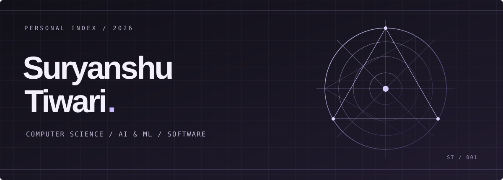
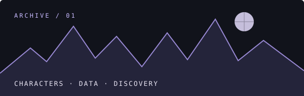
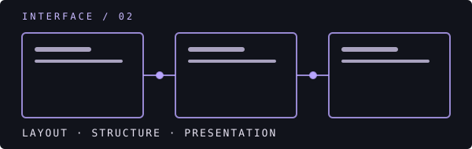
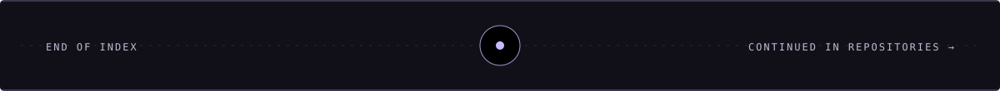

 

<a href="https://github.com/Suryanshu-Tiwari-gh?tab=repositories">REPOSITORIES</a>
&nbsp;·&nbsp;
<a href="https://github.com/Suryanshu-Tiwari-gh?tab=stars">STARS</a>
&nbsp;·&nbsp;
<a href="https://github.com/Suryanshu-Tiwari-gh">PROFILE</a>

 

<table>
<tr>
<td width="62%" valign="top">

### 00 / ABOUT

I’m **Suryanshu Tiwari**, a Computer Science & Engineering undergraduate focused on **AI/ML and software engineering**.

I’m drawn to the space between theory and implementation: understanding an algorithm, designing an interface, working with data, and turning an idea into a system that can be used.

I value clear thinking, deliberate engineering, and projects that make the underlying problem interesting.

</td>
<td width="38%" valign="top">

### 01 / CURRENTLY INTERESTED IN

- Machine learning & applied AI
- Algorithms and computational thinking
- Frontend engineering
- Backend systems and databases
- NLP and speech technologies

</td>
</tr>
</table>

---

## 02 / SELECTED WORK

<table>
<tr>
<td width="50%" valign="top">

### GOTHAM CITY ARCHIVE

A searchable digital archive for characters across the DC universe, built around data retrieved from a public superhero API.

The project explores asynchronous JavaScript, API integration, data transformation, and interface design.

**Stack**  
`JavaScript` `HTML` `CSS` `REST API`

[ SOURCE ↗](https://github.com/Suryanshu-Tiwari-gh/Gotham-City_Archive)

</td>
<td width="50%" valign="top">

### CONNECTHUB

A social-platform capstone project inspired by community and communication products. The public repository documents an early static implementation with three interface pages.

A practical exercise in layout, styling, visual hierarchy, and translating a product reference into a working interface.

**Stack**  
`HTML` `CSS`

[ SOURCE ↗](https://github.com/Suryanshu-Tiwari-gh/ConnectHub-CapStone_Project)  
[ LIVE SITE ↗](https://suryanshu-tiwari-gh.github.io/ConnectHub-CapStone_Project/)

</td>
</tr>
</table>

## 03 / CONTRIBUTIONS & COLLABORATION

**DCODE — Open-source development initiative**  
Participated in the contributor community around student-led open-source development and collaborative project work.

[ COMMUNITY REPOSITORY ↗](https://github.com/Suryanshu-Tiwari-gh/DCODE-Smaple-Repo)

**Game Idea Hub**  
A community game-concept repository for sharing and exploring ideas. Listed separately from original projects.

[ REPOSITORY ↗](https://github.com/Suryanshu-Tiwari-gh/Game-dea-Hub-A)

---

## 04 / WORKING TOOLKIT

<table>
<tr>
<td valign="top" width="50%">

**LANGUAGES**

**FRONTEND**

</td>
<td valign="top" width="50%">

**BACKEND & DATA**

**DEVELOPER TOOLS**

</td>
</tr>
</table>

Tools shown are technologies I have worked with or am actively exploring. The list is not a claim of equal depth across every tool.

## 05 / GITHUB, IN MOTION

 

---

## 06 / OFF-SCREEN

Chess · history · mythology · cinema · anime · games · martial arts.

AN OPEN NOTEBOOK. UPDATED AS THE WORK EVOLVES.

